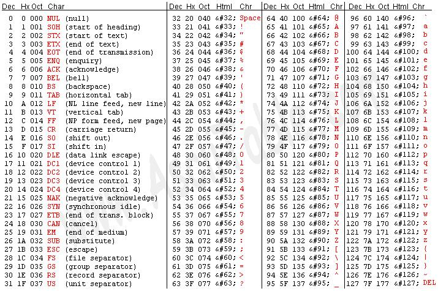

# Седмица 1 - Променливи, константи и оператори

## 1. Tипове данни
- Примитивни:
    - Целочислени: short, int, long, long long
        - без знак: unsigned [<тип>], size_t
    - С плаваща запетая: float, double
    - Символ: char
    - Булев: bool
        - `true` = 1 и `false` = 0
- Съставни: масиви, низове, структури

### Преобразуване между типове
- Имплицитно:
```cpp
float number = 5.5;
int digit = number;
std::cout << digit << std::endl;
```

- Експицитно:
```cpp
char symbol = 'a';
std::cout << (int) symbol<< std::endl;
```

## 2. Променливи и константи
- Променливи:
    ```
    <тип> <идентификатор> [=<стойност>]; 
    ```
    `<идентификатор>` - името на променливата. НЕ МОЖЕ да започва с цифра или да съвпада със запзена дума на програмния език!

- Константи:
    ```
    const <тип> <идентификатор> =<стойност>; 
    ```
    `<идентификатор>` - за имената на константите е прието да се използва UPPERCASE

## 3. Оператори
- Видове:
    - Аритметични
        - бинарни: `+`, `-`, `*`, `/`, `%`
        - унарни: `-`, `++`, `--`
    - тернарен: `? : `
    - За сравнение: `<`, `>`, `<=`, `>=`, `==`, `!=`
    - Логически: `&&` (конюнкция), `||` (дизюнкция), `!` (отрицание)
    - За присвояване: `=`
        - Съкратени версии: `+=`, `-=`, `*=`, `/=`, `%=`
        - Употреба: `a = a + b` -> `a += b`
    - За вход и изход: `std::cin >>`, `std::cout <<`

- Свойства на операторите:
    - Приоритет: `(a + b) * c` равно ли е на `a + b * c`
    - Асоциативност: `a + b` равно ли е на `b + a`
    - Инфиксен: `a + b` 
    - Постфиксен: `a++` - връща стойността на `a` и добавя 1 
    - Префиксен: `++а` - добавя 1 и връща стойността на `a`


# Задачи
## Задача 1
Напишете програма, която прочита три цели числа и отпечатва на екрана дали сумата на първите две се дели на третото.

## Задача 2
Какво прави следният програмен фрагмент:
```cpp
    char firstDigit, secondDigit, thirdDigit;

    std::cin >> firstDigit >> secondDigit >> thirdDigit;

    unsigned short number = 0;
    number += (firstDigit - '0') * 100;
    number += (secondDigit - '0') * 10;
    number += (thirdDigit - '0') * 1;

    std::cout << number << std::endl;
```

## Задача 3
Какво ще отпечата на екрана следния фрагмент:
```cpp
double a = 0.3, b = 0.6, c = 0.9;
double sum = a + b;

bool areEqual = sum == c;
std::cout << std::boolalpha << areEqual << std::endl;
```

## Задача 4
Какво ще отпечата на екрана следния фрагмент:
```cpp
unsigned short a = 2, b = 5, c = 6;

bool dummyOr = a == b || a++ ;
bool dummyAnd = b-- && b == c && a++;
bool dummyCheck = a == b || b++ && c-- || a++ && b == c;

std::cout << "a: " << a << ", b: " << b << ", c: " << c << std::endl;
std::cout << std::boolalpha;
std::cout << "dummyOr: " << dummyOr;
std::cout << ", dummyAnd: " << dummyAnd;
std::cout << ", dummyCheck: " << dummyCheck << std::endl;
```

## Задача 5
Напишете програма, която прочита две положителни целочислени четирицифрени числа и отпечатва на екрана дали конкатенацията им е палиндром.

| Вход  | Изход |
|-----------|---|
|`5432 2345`|`1`|
|`1234 4621`|`0`|

## Задача 6
Напишете програма, която прочита положително число и отпечатва на екрана дали то е ASCII код на голяма латинска буква.



*Note: Решението на задачата не изисква да знаете наизуст ASCII Таблицата. Добавена е тук само с информативна цел!*

## Задача 7
Напишете програма, която прочита от конзолата радиуса и височината на прав кръгов цилиндър и отпечатва на екрана:
- лицето на основата: `B = PI * r^2`;
- околната повърнина: `S = 2 * PI * r * h`;
- пълната повърхнина: `S1 = S + 2 * B`;
- обема: `V = B * h`.

*Note: Нека за целите на задачата приемем, че `PI = 3.14`, и че входът е валиден*

## Задача 8
Напишете програма, която прочита три точки в Декартова координатна система и отпечатва на екрана дали те образуват триъгълник.

## Задача 9
Напишете програма, която чете две пресичащи се окръжности, определени от своя център и радиус. След тях да се въвежда точка. Да се отпечата на екрана дали тя принадлежи на сечението на двете окръжности.

## Задача 10 - Зоомагазин
Кирил е собственик на зоомагазин, който продава котки и папагали. Витрината му има 9 клетки, подредени в 3 реда и 3 колони.

Подредба:
| | *Таван* | |
|--|:--:|--|
| 1 | 2 | 3 |
| 4 | 5 | 6 |
| 7 | 8 | 9 |
| |***Под***| |

Всяка клетка може да е празна, да има котка или да има папагал. Подредбата на животните трябва да изпълнява следните правила:
- Папагалите обичат да са нависоко, затова не може да са в клетките на пода;
- Папагалите са общителни животни, затова не може да има папагал, който няма за съсед друг папагал;
- Не може папагал да има повече от две котки за съседи, защото котките могат да работят заедно и да го изядят.

Помогнете на Кирил, като напишете програма, която прочита 9 символа от конзолата, които може да са само `c`, `p` и `e`, съответно отговарящи на `котка`, `папагал` и `празна клетка`, и отпечатва на екрана дали подредбата им е валидна. 

Примери:

Вход: 
```
p p c
c p p 
c e e
``` 
Изход: `true`

---
Вход: 
```
p p c
c p p 
c e c
```

Изход: `false`


*Note 1: За съседни клетки приемаме само клетките под, над, отляво и отдясно на дадена клетка.*

*Note 2: Задачата е предвидена да се реши **само със знанията от тази тема!***
