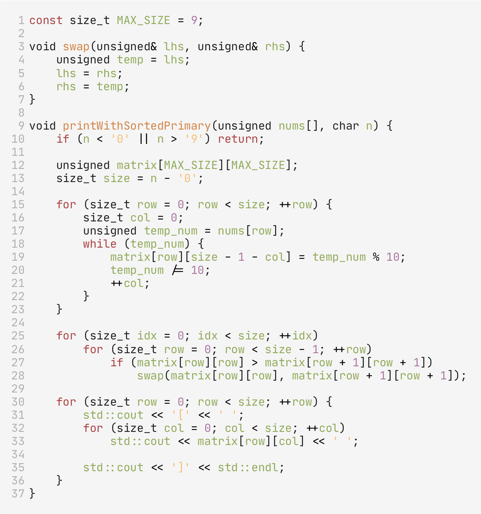
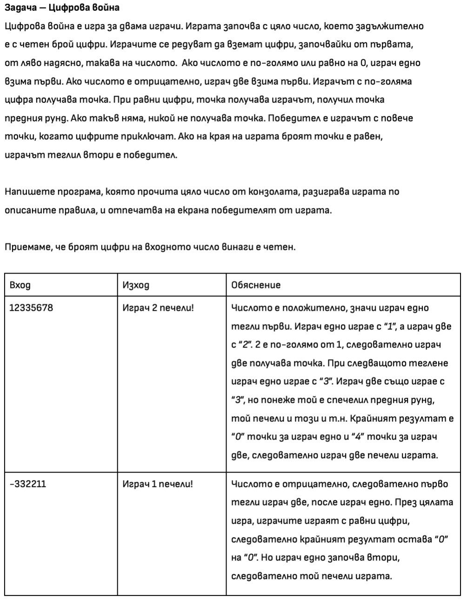
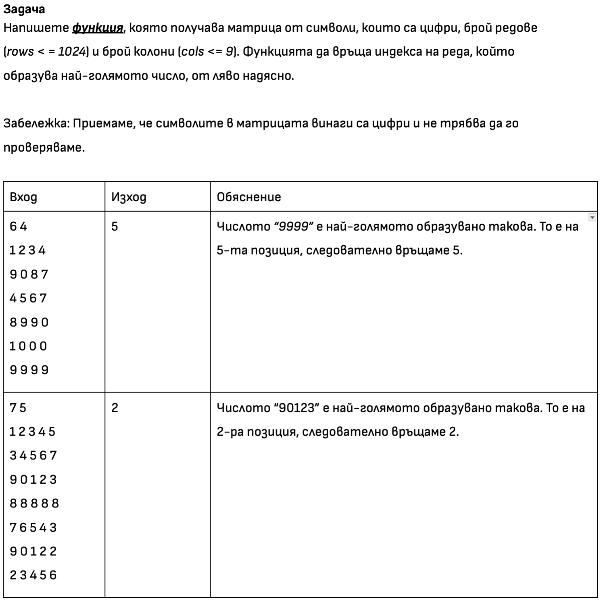
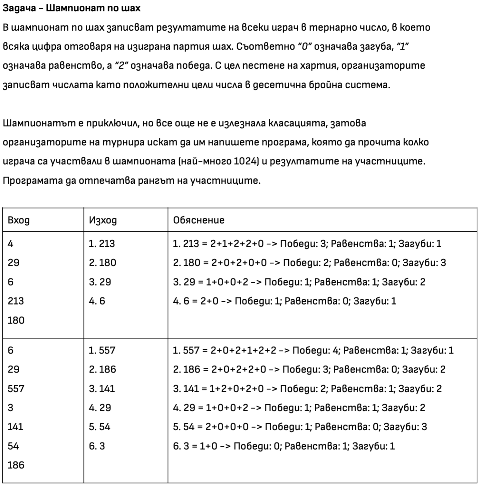

# Седмица 6 - Подготовка за контролно №1
## Пример "Основни алгоритми"

- Показани идеи:
    - Ред 1: Константа за размер на матрица;
    - Ред 3 до 7: Алгоритъм за размяна чрез псевдоними;
    - Ред 9: Подаване на масив на функция;
    - Ред 10: Проверка за валидни данни;
    - Ред 12: Създаване на матрица;
    - Ред 13: Преобразуване на символ в цифра
    - Ред 13: създаване на “променлив” размер на масив;
    - Ред 15 до 23: Обхождане (въвеждане) на матрица;
    - Ред 17 до 22: “Обхождане на число” (Превръщане на число в масив от цифри);
    - Ред 25 до 28: Сортиране, посредством методът на мехурчето;
    - Ред 26 до 28: Обхождане на главния диагонал на матрица;
    - Ред 30 до 36: Обхождане (отпечатване) на матрица;

# Задачи

___

___

