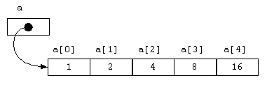
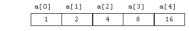
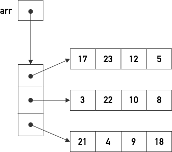
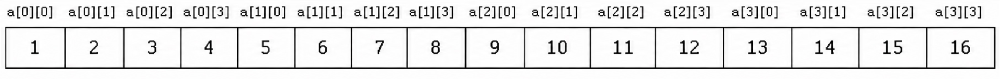
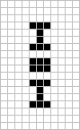
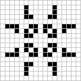

# Седмица 7 - Масиви Част 2

## 1. Едномерни масиви и Адресна аритметика


- Масивът е константен указател към първия си елемент:
```cpp
int arr[] = {1, 2, 3};
int one = 1, two = 2, three = 3;
int * const wannaBeArr = &one;
```
- За разлика от обикновен указател, масивът ни гарантира, че клетките са подредени на последователни адреси в паметта:



- Това означава, че можем "да се местим" по клетките на масив, чрез операции върху указатели:
```cpp
int arr[] = {1, 2, 3};
std::cout << *arr << std::endl;
std::cout << *(arr + 1) << std::endl;
std::cout << *(arr + 2) << std::endl;
```
- Отместването става спрямо размера на типа на указателя. Това е така, защото винаги искаме да се отместваме с "един елемент".
```cpp
short shortNum = 10;
int num = 10;
long longNum = 10;
short* shorteger = &shortNum;
int* integer = &num;
long* longeger = &longNum;
std::cout << &shortNum << " + 1 = " << shorteger + 1 << std::endl;
std::cout << &num << " + 1 = " << integer + 1 << std::endl;
std::cout << &longNum << " + 1 = " << longeger + 1 << std::endl;
```

- Също така, щом масивът е **КОНСТАНТЕН** указател към първия си елемент, то това обяснява защо **НЕ МОЖЕМ** да присвояваме масиви.
```cpp
int arr[] = {1, 2, 3};
int brr[] = {0, 0, 0};
arr = brr; // error: array type 'int[3]' is not assignable
```
- Както и защо **НЕ МОЖЕМ** да използваме `std::cin` за директно приемане на масив от конзолата!

- А какво прави `arr[i]` и защо индексирането ни започва от `0`?

## 2. Едномерни масиви и функции
- Какво става ако подадем масив на функция?
```cpp
const size_t SIZE = 10;
void printArray(int arr[SIZE], size_t size);
void printArray(int const arr[SIZE], size_t size);
void printArray(const int arr[SIZE], size_t size);
void printArray(int* arr, size_t size);
void printArray(int* const arr, size_t size); // !!!
void printArray(const int* arr, size_t size);
```
- Оказва се, че компилатора приема `printArray(int arr[SIZE], size_t size)` като `printArray(int* arr, size_t size)`.
- Това е така, защото на компилатора му трябва само големината на клетката или с други думи колко е отместването в паметта за един елемент. Самата дължина на масива не е от значение (*извън декларацията му*).

- Може ли тази сметка да се направи и за многомерни масиви?

## 3. Двумерни масиви в паметта
- Двумерните масиви са, както вече споменахме, масиви от масиви.
- Спрямо това, което си казахме до момента, логично следва и какво ще бъде представянето на матрица в паметта.



- Като отново имаме по-силното твърдение, че всички клетки са подредени на последователни адреси в паметта.

- Тази подредба предоставя много различни начини за достъпване на даден елемент в матрица.
```cpp
void printEqual(unsigned* lhs, unsigned* rhs) {
    std::cout << std::boolalpha;
    std::cout << lhs << " == " << rhs << " -> " << (lhs == rhs) << std::endl;
}

int main() {
    unsigned matrix[][4] = {
        {1, 2, 3, 4},
        {5, 6, 7, 8},
        {9, 10, 11, 12},
        {13, 14, 15, 16}
    };
    
    printEqual((unsigned*) matrix, &matrix[0][0]);
    printEqual((unsigned*) (matrix + 2), matrix[2]);
    printEqual((unsigned*) (matrix + 2), &matrix[2][0]);
    printEqual(*matrix + 12, matrix[3]);
    printEqual(*matrix + 12, &matrix[3][0]);
    printEqual(*matrix + 6, *(matrix + 1) + 2);
    printEqual(*matrix + 6, &matrix[1][2]);
    
    return 0;
}
```

Note: За всички, които все още не вярват във функции:
```cpp
unsigned matrix[][4] = {
    {1, 2, 3, 4},
    {5, 6, 7, 8},
    {9, 10, 11, 12},
    {13, 14, 15, 16}
};

std::cout << std::boolalpha;
std::cout << matrix << " == " << matrix[0] << " -> " << ((unsigned*) matrix == matrix[0]) << std::endl;
std::cout << matrix << " == " << &matrix[0][0] << " -> " << ((unsigned*) matrix == &matrix[0][0]) << std::endl;
std::cout << matrix + 2 << " == " << matrix[2] << " -> " << ((unsigned*) (matrix + 2) == matrix[2]) << std::endl;
std::cout << matrix + 2 << " == " << &matrix[2][0] << " -> " << ((unsigned*) (matrix + 2) == &matrix[2][0]) << std::endl;
std::cout << *matrix + 12 << " == " << matrix[3] << " -> " << (*matrix + 12 == matrix[3]) << std::endl;
std::cout << *matrix + 12 << " == " << &matrix[3][0] << " -> " << (*matrix + 12 == &matrix[3][0]) << std::endl;
std::cout << *matrix + 6 << " == " << *(matrix + 1) + 2 << " -> " << (*matrix + 6 == *(matrix + 1) + 2) << std::endl;
std::cout << *matrix + 6 << " == " << &matrix[1][2] << " -> " << (*matrix + 6 == &matrix[1][2]) << std::endl;
```

## 4. Двумерни масиви и функции
- При едномерните масиви казахме, че компилатора може да пресметне отместването в паметта от типа на указателя.
```cpp
const size_t ROWS = 10, COLS = 10;
void printMatrix(int matrix[ROWS][COLS], size_t rows, size_t cols);
void printMatrix(int* matrix[COLS], size_t rows, size_t cols);
void printMatrix(int** matrix, size_t rows, size_t cols)
```
- От темата за указатели знаем, че размерът на указател е винаги един и същ независимо от типа на това, към което сочи.
- Типът на указателят е важен само, за да знаем с колко адреса в паметта да се отместим, за да сме винаги в началото на клетката данни.
```cpp
int* a; // Но когато подаваме матрица,
int* b; // колоните не винаги са еднакви!
bool equal = sizeof(a) == sizeof(b);
```
- Вече трябва да е ясно, че компилаторът не може сам да сметне колко е отместването на външния указател, ако не знае размера на данните на вътрешния. 
```cpp
int nums[2][2] = {
    {1, 2},
    {3, 4}
};
int dums[2][4] = {
    {1, 2, 3, 4},
    {5, 6, 7, 8}
};
```
- Ако позволим размера на вътрешния указател да е неизвестен, то ние ще третираме `nums` и `dums` по един и същи начин. Нека приемем, че размера на `nums` е нашия фиксиран размер на всеки един вътрешен указател на матрица. Това е непрактично, защото: 
- отместване с една `nums` единица  в `nums`
```cpp
size_t intOneStep = 1;
size_t numsOneStep = intOneStep * 2;
std::cout << *(*nums + numsOneStep) << std::endl;
```
ще ни изпрати на първата клетка на втория ред. 
- oтместване с една `nums` единица в `dums`
```cpp
std::cout << *(*dums + numsOneStep) << std::endl;
```
ще ни изпрати на клетката на третата клетка на първи ред, а не на първата клетка на втория ред, както бихме очаквали.

- Затова и ни трябва размера на вътрешния указател: За да знаем с колко адреса трябва да се отместим, за да стигнем на следващия елемент (ред).

# Задачи
## Задача 0 - Храна за размислъл
### 1. Изчисляване на размер:
```cpp
int nums[] = {1, 2, 3, 4};
size_t size = sizeof(nums) / sizeof(int);
std::cout << size << std::endl;
```

### 2. Изчисляване на "размер":
```cpp
size_t getArraySize(const int arr[]) {
    return sizeof(arr) / sizeof(int);
}
```

### 3. Ходим назад:
```cpp
int nums[] = {1, 2, 3, 4, 5, 6, 7, 8, 9, 10};

size_t size = sizeof(nums) / sizeof(nums[0]);

int* numsPtr = nums + (size - 1);
while (numsPtr >= nums) {
    std::cout << *numsPtr << ' ';
    --numsPtr;
}

std::cout << std::endl;
```

### 4. Палачинкосване
```cpp
const size_t ROWS = 5, COLS = 4, SIZE = ROWS * COLS;

void printFixedMatrix(const int matrix[ROWS][COLS]) {
    for (size_t row = 0; row < ROWS; ++row) {
        for (size_t col = 0; col < COLS; ++col)
            std::cout << matrix[row][col] << ' ';
        
        std::cout << std::endl;
    }
}

void printFixedArray(const int arr[SIZE]) {
    for (size_t idx = 0; idx < SIZE; ++idx)
        std::cout << arr[idx] << ' ';
}

int main() {
    int matrix[ROWS][COLS] = {
        {1, 2, 3, 4},
        {5, 6, 7, 8},
        {9, 10, 11, 12},
        {13, 14, 15, 16},
        {17, 18, 19, 20},
    };

    int* arr = &matrix[0][0];

    printFixedMatrix(matrix);
    printFixedArray(arr);
    return 0;
}
```

### 5. "За всеки случай":
```cpp
const size_t NUMS_SIZE = 10;
double nums[NUMS_SIZE + 1];

for (size_t idx = 1; idx < NUMS_SIZE + 1; ++idx) {
    std::cin >> nums[idx];
    nums[0] += nums[idx];
}

nums[0] /= NUMS_SIZE;

std::cout << "Average: " << nums[0] << std::endl;
```

## Задача 1
Напишете функция, която получава масив и размерът му и отпечатва елементите му на равни разстояния от центъра като наредени двойки.

Примери:
- Масив: `[1, 2, 3, 4, 5, 6, 7, 8, 9, 10]`; Изход: `(1, 10); (2, 9); (3, 8); (4, 7); (5, 6);`
- Масив: `[0, 1, 2, 3, 4, 5, 6, 7, 8, 9, 10]`; Изход: `(0, 10); (1, 9); (2, 8); (3, 7); (4, 6); (5);`

## Задача 2
Напишете програма, която прочита размера `n` на квадратна матрица от цели числа (`n <= 1024`) и самата матрица от клавиатурата и отпечатва на екрана участъка с най-големата сума на елементите. Участък ще наричаме една от следните четири съвкупности от елементи: Елементите под главния диагонал, елементите над главния диагонал, елементите под вторичния диагонал, елементите над вторичния диагонал.

Примери:
- Вход #1:
```
4
  5  12  -3   8
 17  -6   4  11
 -2  23   9  -5
 14   7  19   3
```
- Изход #1:
```

17
-2 23
14 7 19
```

- Вход #2:
```
6
  8  15  -4   7  12  -3
 -5   9  18  -2  11   6
 14  -7   5  21  -8  13
  3  16  -6   4  19  -1
-10   2  17  -5   7  22
 11  -3   8  14  -9   6
```
- Изход #2:
```
15 -4 7 12 -3
  18 -2 11 6
    21 -8 13
      19 -1
        22
```

## Задача 3
Напишете функция, която получава `N*N` квадратна матрица (`N = 10`) и ъгъл (в градуси) като цяло положително число. Ъгълът може да бъде само `0`, `90`, `180` или `270`. Функцията да обръща матрицата съответните спрямо получения ъгъл.

Note: Може да си направите отделна функция, която да принтира матрицата с цел да видите дали първоначално изисканата от Вас функция работи акуратно.

Примери:
- 0 градуса:
```
1 2 3 4 5 6 7 8 9 10 
11 12 13 14 15 16 17 18 19 20 
21 22 23 24 25 26 27 28 29 30 
31 32 33 34 35 36 37 38 39 40 
41 42 43 44 45 46 47 48 49 50 
51 52 53 54 55 56 57 58 59 60 
61 62 63 64 65 66 67 68 69 70 
71 72 73 74 75 76 77 78 79 80 
81 82 83 84 85 86 87 88 89 90 
91 92 93 94 95 96 97 98 99 100 
```

- 90 градуса:
```
91 81 71 61 51 41 31 21 11 1 
92 82 72 62 52 42 32 22 12 2 
93 83 73 63 53 43 33 23 13 3 
94 84 74 64 54 44 34 24 14 4 
95 85 75 65 55 45 35 25 15 5 
96 86 76 66 56 46 36 26 16 6 
97 87 77 67 57 47 37 27 17 7 
98 88 78 68 58 48 38 28 18 8 
99 89 79 69 59 49 39 29 19 9 
100 90 80 70 60 50 40 30 20 10 
```

- 180 градуса:
```
100 99 98 97 96 95 94 93 92 91 
90 89 88 87 86 85 84 83 82 81 
80 79 78 77 76 75 74 73 72 71 
70 69 68 67 66 65 64 63 62 61 
60 59 58 57 56 55 54 53 52 51 
50 49 48 47 46 45 44 43 42 41 
40 39 38 37 36 35 34 33 32 31 
30 29 28 27 26 25 24 23 22 21 
20 19 18 17 16 15 14 13 12 11 
10 9 8 7 6 5 4 3 2 1 
```

- 270 градуса:
```
10 20 30 40 50 60 70 80 90 100 
9 19 29 39 49 59 69 79 89 99 
8 18 28 38 48 58 68 78 88 98 
7 17 27 37 47 57 67 77 87 97 
6 16 26 36 46 56 66 76 86 96 
5 15 25 35 45 55 65 75 85 95 
4 14 24 34 44 54 64 74 84 94 
3 13 23 33 43 53 63 73 83 93 
2 12 22 32 42 52 62 72 82 92 
1 11 21 31 41 51 61 71 81 91
```

## Задача 4
Напишете програма, която прочита рамерът `n` (`n <= 1024`) на масив от цели числа и самия масив. Програмата да отпечатва на екрана началният индекс и размерът на най-дългият строго разстящ подмасив на масива.

Примери:
- Вход #1:
```
10
1 2 3 4 4 5 6 7 8 0
```
- Изход #1: `4 5`

- Вход #2:
```
8
-9 -7 -5 -5 -3 -1 0 2
```
- Изход #2: `3 5`

- Вход #3:
```
9
1 2 3 0 4 5 6 9 8
```
- Изход #3: `3 5`

## Задача 5
Имате дадена програма. Попълнете я, като напишете функция, която получава масив от символи и размерът му. Функцията получава и още един аргумент: `unsigned values[127]`. Функцията трябва да запише броя на всеки уникален символ на масива във `values`. Програмата трябва да отпечатва резултататът по указания начин:
```cpp
#include <iostream>

const size_t MAX_SYMMOLS = 127;

/* Напишете решението си тук! */

int main() {
    char symbols[] = {
        '?', '?', '=', '#', '!', '&', '#', '@', '#', '^',
        '@', '#', '&', '&', '@', '?', '?', '+', '@', '?',
        '*', '*', '*', '$', '^', '&', '%', '*', '%', '*',
        '#', '?', '&', '!', '@', '?', '$', '&', '%', '#',
        '?', '*', '?', '?', '#', '!', '!', '!', '#', '*',
        '!', '?', '#', '&', '#', '?', '&', '!', '*', '!',
        '*', '#', '#', '!', '^', '#', '^', '?', '=', '*',
        '#', '+', '&', '+', '&', '=', '*', '@', '%', '^',
        '!', '*', '*', '=', '$', '#', '&', '@', '#', '@',
        '%', '#', '#', '*', '*', '*', '+', '#', '#', '^'
    };

    unsigned values[MAX_SYMMOLS] = {};

    /* Извикайте функциите си тук! */

    /* Очакван изход:
    ('!', 10) ('#', 20) ('$', 3) ('%', 5) ('&', 11) ('*', 16) ('+', 4) ('=', 4) ('?', 13) ('@', 8) ('^', 6)
    */

    return 0;
}
```

## Задача 6
Имате дадена програма. Допишете я така, че да отпечатва максималната сума, която може да се получи при сумиране на елементите на квадратна подматрица на `n*n` матрица.
```cpp
#include <iostream>

const size_t MAX_N = 1024;

size_t getValidSize(const size_t& boundary) {
    size_t n;
    do {
        std::cout << "Input n: ";
        std::cin >> n;
    } while (n > boundary);

    return n;
}

void inputMatrix(int matrix[MAX_N][MAX_N], size_t n) {
    for (size_t row = 0; row < n; ++row)
        for (size_t col = 0; col < n; ++col)
            std::cin >> matrix[row][col];
}

/* Препоръчително е да си направите и други помощни функции! */

int maxSumFromSubmatrix(const int matrix[MAX_N][MAX_N], size_t size) {
    /* Попълнете функцията! */
}

int main() {
    size_t size = getValidSize(MAX_N);
    int matrix[MAX_N][MAX_N];
    inputMatrix(matrix, size);

    std::cout << maxSumFromSubmatrix(matrix, size) << std::endl;

    return 0;
}
```

Пример:
- Вход:
```
4
-5  -2  -8   1
 3   4  -6   2
-1   5   7  -3
-9  -4   2   6
```
- Изход: `13`
- Обяснение: Подматрицата е
```
4  -6   2
5   7  -3
-4   2   6
```

## Задача 7
Напишете функция, която получава масив от числа, размерът му и операция `+`, `-`, `*` и `\` и връща стойността получена след прилагане на избраната операция.

- Вход: `[1.5, 2.75, 4.25, 6, 0.5]` с `+`; Изход: `15`
- Вход: `[10.5, 5, 2.25, 1.25]` с `-`; Изход: `-19`
- Вход: `[2.5, 2, 0.25, 10, 1.5, 2]` с `*`; Изход: `37.5`
- Вход: `[0.25, 2, 0.5, 4, 2]` с `/`; Изход: `0.5`

## Задача 8
|[Conway's](https://en.wikipedia.org/wiki/Conway%27s_Game_of_Life)|[Game of Life](https://en.wikipedia.org/wiki/Conway%27s_Game_of_Life)|
|-:|:-|
|||

Напишете функция, която получава `N*N` игрална площадка. Площадката представлява матрица, на която всяка клетка има две възможни (значими) състояния: `Жива` или `Мъртва`. Функцията получава и цяло неотрицателно число, което представлява броят *поколения*. Поколение е стъпка във играта и по време на изпълнението едновременно се прилагат следните промени вурху игралното поле:
1. Всяка жика клетка с **по-малко от двама** живи съседа умира, защото и е *самотно*!
2. Всяка жиква клетка с **два или три** живи съседа продължава да живее!
3. Всяка жива клетка с **повече от трима** живи съседа умира, защото и е *пренаселено*!
4. Всяка мъртва клетка с **точно три** живи съседа оживява, поради *размножаване*!

Вашата функция трябва да изпълнява подадения брой *поколения* без помощнa матрицa (да става inplace).

Примери:
```cpp
void printBoard(char board[N][N]) {
    for (size_t row = 0; row < N; ++row) {
            for (size_t col = 0; col < N; ++col)
                std::cout << board[row][col] << ' ';
   
        std::cout << std::endl;
    }
}
```
- Програмен фрагмент #1:
```cpp
char board[N][N] = {
    {'d','d','d','d','d','d','d','d','d','d'},
    {'d','d','d','d','d','d','d','d','d','d'},
    {'d','d','d','d','d','d','d','d','d','d'},
    {'d','d','d','d','d','d','d','d','d','d'},
    {'d','d','d','d','l','l','d','d','d','d'},
    {'d','d','d','d','l','l','d','d','d','d'},
    {'d','d','d','d','d','d','d','d','d','d'},
    {'d','d','d','d','d','d','d','d','d','d'},
    {'d','d','d','d','d','d','d','d','d','d'},
    {'d','d','d','d','d','d','d','d','d','d'}
};

doGenerations(board, 5);

printBoard(board);
```

- Ихзод #1:
```
d d d d d d d d d d 
d d d d d d d d d d 
d d d d d d d d d d 
d d d d d d d d d d 
d d d d l l d d d d 
d d d d l l d d d d 
d d d d d d d d d d 
d d d d d d d d d d 
d d d d d d d d d d 
d d d d d d d d d d 
```

- Програмен фрагмент #2:
```cpp
char board[N][N] = {
    {'d','d','d','d','d','d','d','d','d','d'},
    {'d','d','d','d','d','d','d','d','d','d'},
    {'d','d','d','d','d','d','d','d','d','d'},
    {'d','d','d','d','d','d','d','d','d','d'},
    {'d','d','d','l','l','l','d','d','d','d'},
    {'d','d','d','d','d','d','d','d','d','d'},
    {'d','d','d','d','d','d','d','d','d','d'},
    {'d','d','d','d','d','d','d','d','d','d'},
    {'d','d','d','d','d','d','d','d','d','d'},
    {'d','d','d','d','d','d','d','d','d','d'}
};

doGenerations(board, 2);

printBoard(board);
```
- Ихзод #2:
```
d d d d d d d d d d 
d d d d d d d d d d 
d d d d d d d d d d 
d d d d d d d d d d 
d d d l l l d d d d 
d d d d d d d d d d 
d d d d d d d d d d 
d d d d d d d d d d 
d d d d d d d d d d 
d d d d d d d d d d 
```

- Програмен фрагмент #3:
```cpp
char board[N][N] = {
    {'d','d','d','d','d','d','d','d','d','d'},
    {'d','d','l','d','d','d','d','d','d','d'},
    {'d','d','d','l','d','d','d','d','d','d'},
    {'d','l','l','l','d','d','d','d','d','d'},
    {'d','d','d','d','d','d','d','d','d','d'},
    {'d','d','d','d','d','d','d','d','d','d'},
    {'d','d','d','d','d','d','d','d','d','d'},
    {'d','d','d','d','d','d','d','d','d','d'},
    {'d','d','d','d','d','d','d','d','d','d'},
    {'d','d','d','d','d','d','d','d','d','d'}
};

doGenerations(board, 3);

printBoard(board);
```
- Ихзод #3:
```
d d d d d d d d d d 
d d d d d d d d d d 
d d l d d d d d d d 
d d d l l d d d d d 
d d l l d d d d d d 
d d d d d d d d d d 
d d d d d d d d d d 
d d d d d d d d d d 
d d d d d d d d d d 
d d d d d d d d d d
```
